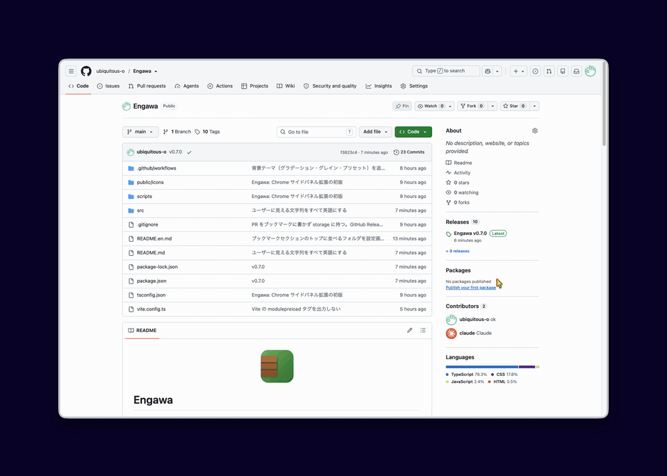

<p align="center"></p>

# Engawa

[English](README.en.md)

家の横に張り出した板の間、縁側。Chrome のサイドパネルに「お気に入り・ブックマーク・GitHub PR・開いているタブ」を縦に並べる、自分用の Manifest V3 拡張。
お気に入りはブックマークバーのフォルダそのものを表示するだけで（複数選べる）、拡張はブックマークに何も書かない（pin タブも使わない）。拡張を消しても、別ブラウザに移っても、ブックマークはそのまま残る。拡張が独自に持つのは設定・GitHub トークン・PR 一覧・タブ対応表だけ。

<p align="center"></p>

## インストール

[Releases](https://github.com/ubiquitous-o/Engawa/releases) から `engawa-vX.Y.Z.zip` を落として展開し、下の手順 1〜2 で展開したフォルダを読み込む。

**ブラウザは [Vivaldi](https://vivaldi.com/ja/) を推奨。** Chrome 系ならどれでも動くが、Vivaldi はサイドパネルを Chrome の最小幅（およそ 320px）より狭くでき、タブバーやアドレスバーも自前の設定で隠せるので、Arc に近い見た目にしやすい。Vivaldi では `vivaldi://extensions` から読み込む。

## ソースからビルドして読み込む

```bash
npm install
npm run build
```

1. `chrome://extensions` を開き、右上の **デベロッパーモード** をオン
2. **パッケージ化されていない拡張機能を読み込む** → このリポジトリの `dist/` を選ぶ
3. ツールバーのアイコンをクリック、または **Alt+S** でサイドパネルが開く

お気に入りは専用フォルダを持たず、ブックマークバー配下の好きなフォルダを「Show as favorites」する。複数選ぶとフォルダごとにセクションが並ぶ。未設定ならブックマークバー直下。タイルの大きさは設定画面の「Favorites icon size」で変えられる。

ブックマークセクションは既定でツリー全体（ブックマークバー、その他のブックマーク…）を並べる。設定画面の「Folder shown in Bookmarks」で特定のフォルダを選ぶと、その中身がセクションのトップに来る。

拡張 ID は `manifest.json` の `key`（公開鍵）で固定している（`lmjcicaaeilbjpcbimnclhafocijlifc`）。パッケージ化されていない拡張は本来フォルダの場所から ID が決まるので、Releases の zip を別の場所に展開して読み込み直すと別の拡張扱いになり設定が消えるが、`key` があればどこから読み込んでも同じ ID になり、設定・トークン・お気に入りフォルダの選択がそのまま残る。同じ ID の拡張は同時に 1 つしか読み込めないので、入れ替えるときは古い方を削除してから読み込む。`key` は公開鍵で秘密ではなく、パッケージ化されていない拡張の読み込みには秘密鍵は要らないので、鍵の管理は何もない。

開発中は `npm run dev`（`vite build --watch`）で `dist/` を更新し続け、`chrome://extensions` の更新ボタンで再読み込みする。

リリースは `package.json` の `version` を上げて `v` 付きのタグを push すると、GitHub Actions が zip を作って Releases に添付する。手元で zip を作るだけなら `npm run package`（`release/` に出る）。

## GitHub 連携

1. トークンを作る。自分が関わる PR を全部拾いたいので、リポジトリを手で選ばない種類にする
   - **Classic トークン**（推奨）: [作成ページ](https://github.com/settings/tokens/new) でスコープ **`repo`** にチェック。自分のリポジトリも所属 org のリポジトリも、後から招待されたものも全部対象になる。SSO を使う org は、作成後に「Configure SSO」でその org を認可する
   - Fine-grained トークンでもよいが、「All repositories」にしても所有者 1 つ分しかカバーできない。org をまたぐなら classic にする
2. 拡張の設定画面（サイドパネル右上の歯車）でトークンを入力して保存。「Test connection」でログイン名が返れば OK
3. 5 分ごと（設定で変更可）に「Review requests」と「My pull requests」がサイドパネルに同期される

- トークンは `chrome.storage.local` にだけ保存する。`storage.sync` には入れず、ログにも出さない
- PR 一覧は `chrome.storage.local` に置く。ブックマークには書かないので、端末ごとにトークンが要る
- 401 → バッジが `!` になり、設定画面へ誘導。403/429 → 次回まで間隔を倍にして再試行
- GitHub Enterprise は設定画面の API ベース URL を `https://ghe.example.com/api/v3` に変える（そのホストへのアクセス許可を求められる）

## 使い方

| 操作 | 動き |
| --- | --- |
| お気に入り右のフォルダ名ボタン / ツリーのフォルダを右クリック → お気に入りとして表示 | お気に入りに出すフォルダを選ぶ（複数可、クリックでオン／オフ）。ツリーでは ★ が付く。全部外すとブックマークバー直下に戻る |
| お気に入りタイルをクリック | 対応タブがあればそこへ切り替え、なければ新しく開く。開いている項目には点が付く |
| お気に入りを右クリック | 元のURLに戻す / タブを閉じる / お気に入りから外す（その他のブックマークへ移動）/ 削除 |
| タブやブックマークをお気に入りにドラッグ | そのフォルダに追加・並べ替え。右クリックの「Add to favorites」はフォルダが複数ならフォルダ名ごとに出る |
| タブをブックマークツリーにドラッグ | フォルダに落とせばそのフォルダへ、行の間なら隣に、下のドロップゾーンならブックマークバーの末尾に追加 |
| ブックマークをドラッグ | 並べ替え、フォルダへ移動 |
| タブ・お気に入り・ブックマークをパネルの外（表示中のページの上）へドラッグ | 表示中のタブと隣に寄せて分割表示（Split View）にする。お気に入りとブックマークは、開いていなければ開いてから並べる。ページの左半分で離せば左、右半分なら右に入る。Vivaldi では上端・下端寄りで離すと上下に並ぶ（Chrome の Split View は左右だけ）。ドラッグ中はパネルにどちら側へ入るかが出る。右クリックの「Unsplit」で解除。Vivaldi では自前のタイル表示、Chrome では 155 以降の `tabs.createSplit` を使う |
| ブックマークをクリック | 新しいタブで開く。URL がお気に入りにあれば、新しいタブを増やさずそのお気に入りのタブとして開く（タイルに印が付く）。中クリック・Cmd+クリックでバックグラウンドに開く。右クリックで「Open in current tab」もある |
| ブックマークをダブルクリック / 右クリック → 名前を変更 | インラインで名前変更 |
| `/` | 検索にフォーカス |
| `↑` `↓` | 項目を移動（セクションをまたぐ） |
| `Enter` | 開く / フォルダ開閉 |
| `←` `→` | フォルダを閉じる / 開く |
| `Esc` | 検索解除 |

お気に入りに対応しているタブは、Arc の固定タブと同じく「Tabs」一覧には出ない。タイルの印だけで表す。

タブ一覧は Chrome 標準の縦タブと重なるので、設定でオフにできる。

## Spotify の再生中表示（スリットスキャン）

Spotify で再生中の曲のジャケットを、Tabs の一番下から操作ボタンの上までの空きに、縦のスリットスキャンで出す。再生位置にあたる横 1 行を縦に引き伸ばして余った高さを埋め、曲が進むとジャケットが下から上へ上がってくる（[StaaaaandBy](https://github.com/ubiquitous-o/StaaaaandBy) と同じ描き方）。一覧が長くて空きが横長になったときは横向きになり、ジャケットが右から左へ動く。収まらない曲名は 2 秒止まってから流れる。パネルの一番下には、曲名と「前の曲・再生/停止・次の曲」のボタンが出る。

1. [developer.spotify.com](https://developer.spotify.com/dashboard) で自分の Spotify アプリを作る（Web API）
2. Engawa の設定画面の Spotify カードに出ている Redirect URI（`https://<拡張ID>.chromiumapp.org/spotify`）を、そのアプリの Redirect URIs に登録する
3. Client ID を設定画面に貼って **Connect**

- サインインは Authorization Code + PKCE で、クライアントシークレットは使わない。トークンと Client ID は端末内（storage.local）だけに置き、`accounts.spotify.com` と `api.spotify.com` にしか送らない
- どの端末で再生していても、アカウントの再生状態を 2 秒ごとに取りに行く（パネルが見えているあいだだけ）。ボタンは再生中の端末に対して効く。操作には Premium が必要
- 設定の「Show now playing」でオフに、「Artwork strength」でジャケットの濃さを変えられる

## Google Meet の自動ピクチャー イン ピクチャー

Chrome は Meet のタブを離れると自動で小窓を出し、戻ると閉じる。Vivaldi は裏に回ったタブを「隠れた」ことにしないので、この動きが発動しない。Engawa がそれを補う。

- Meet を見ているときに、Engawa のタブ・お気に入り・ブックマークをクリックして別のタブへ行くと、その直前に Meet の小窓を開く
- Meet のタブに戻ると小窓を閉じる（こちらはどの方法で戻っても効く）
- 小窓を開く命令は本物の操作の直後にしか通らないので、Vivaldi のタブバーやショートカットで切り替えたときは開かない
- このために `scripting` 権限と `meet.google.com` へのアクセスを使う。Meet 以外のサイトには触らない
- 拡張を更新した後は、開いている Meet のタブを一度読み込み直す

## 見た目の調整

設定画面の「Background」で、Arc のテーマのように背景を作れる。

- **プリセット**: Dusk / Engawa（緑×茶）/ Ocean / Sunset / Lavender / Moss / Slate。右端の **+** で今の設定（色・角度・強さ・グレイン）を名前付きで保存できる。保存したものはホバーの × で削除
- **種類**: 2 色グラデーション、または単色
- **色**: 始点と終点をカラーピッカーで。**角度**は 0〜360°
- **色の強さ**: ベースの白（ダークなら黒）にどれだけ色を混ぜるか
- **グレイン**: Arc 風のざらつき。SVG のノイズを重ねているので画像ファイルは持たない
- 設定画面の背景にもその場で反映されるので、見ながら調整できる

アクセントカラー（選択枠やバッジの色）は背景とは別に選べる。ライト／ダークは OS の設定に追従する。

## Vivaldi でページの角を丸くする

ウィンドウは角丸なのにページが四角いままなのが気になるときの設定。Engawa ではなく Vivaldi 側で行う。

1. 設定 → テーマ → エディター → 「カラー」タブの色の付け方（Coloring Mode）で **Unified** を選ぶ。ページの四隅が丸く切り抜かれるのは、この統合デザインのときだけ
2. 同じエディターの「設定」タブの「角を丸くする」で半径を決める（上限 14）
3. 14 より大きくしたいときは、[vivaldi-custom-css/engawa-corners.css](vivaldi-custom-css/engawa-corners.css) をカスタム CSS として読み込む
   1. `vivaldi://experiments` で「Allow CSS modifications」をオン
   2. 設定 → 外観 → 「オリジナルカスタム UI」の「フォルダーを選択…」で、このリポジトリの `vivaldi-custom-css/` フォルダを選ぶ
   3. Vivaldi を再起動する

   半径はファイルの中の `--radius`（既定 20px）で変える。`--radiusHalf` はその半分にする。変えたら再起動。入力欄やボタンの丸みも同じ値を使うので一緒に変わる。やめるときはフォルダの指定を外す

同じ CSS には、ほかに 2 つの調整が入っている。

- ページの周りの余白を四辺 7px に揃える（Vivaldi の統合デザインは左と上が狭い）
- アドレスバーを非表示にしているときに出る入力欄を、ウィンドウ全体ではなくページの領域の中央に置く。サイドパネルが出ていればページ側の中央、出ていなければ全体の中央になる

同じフォルダの [engawa-hide-titlebar.css](vivaldi-custom-css/engawa-hide-titlebar.css) は別の調整で、「UI を自動で隠す」設定のときに上端から出てくるタイトルバーの帯を出さないようにする。mac の 3 つのボタンは消せないので、上端に寄せるとボタンだけが出る。ウィンドウは上端の見えない帯（14px）をつかんで動かす。要らなければこのファイルだけ外す

## Chrome 側の制約

- **タブバー・URL バーは拡張から隠せない**。Chrome の縦タブ機能でタブバーだけは横から消せる。Vivaldi なら設定で両方とも隠せる
- **サイドパネルの最小幅は Chrome が決めている**（およそ 320px）。拡張からは狭くできない。代わりに設定の「Compact mode」で行とタイルを詰める。Vivaldi はこれより狭くできる

## 構成

```
vivaldi-custom-css/        # Vivaldi 用のカスタム CSS（ページの角丸）。拡張本体には含まれない
src/
  manifest.json
  background/index.ts     # 起動処理、alarms、メッセージ受付
  background/github.ts    # GitHub 検索 API と PR フォルダの差分同期、バッジ、通知
  background/favorites.ts # お気に入り ↔ タブの対応表（storage.session）と URL 照合
  sidepanel/              # サイドパネル UI（Preact）
  options/                # 設定画面
  shared/                 # 型、storage、メッセージ、ブックマーク管理
scripts/gen-icons.mjs     # アイコン PNG を生成（npm run icons）
```

Manifest V3 / TypeScript / Vite / Preact。外部サーバーは使わず、通信先は GitHub API だけ。
